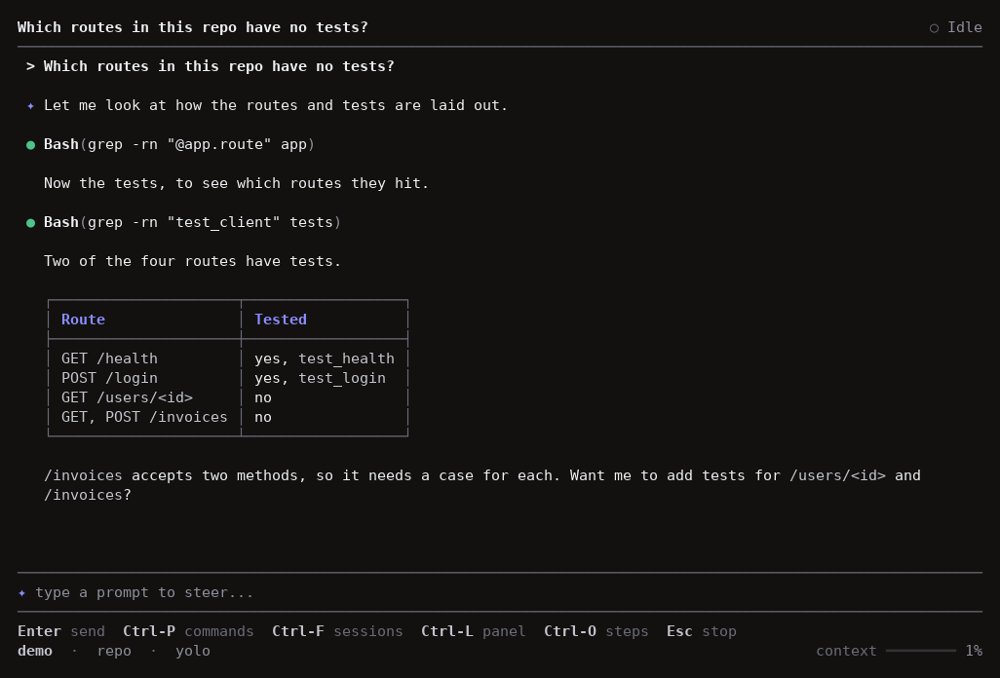

<div align="center">


# snippet

A code-first agent for your terminal, with a phone and desktop app to steer it from anywhere.

[](LICENSE)
[](https://www.rust-lang.org)

</div>



`snippet` runs on your machine, works in your project and keeps every session on disk. One Rust binary provides the terminal UI and the `serve` daemon that the [companion app](https://github.com/wacht-platform/snippet-mobile) connects to.

## Features

- Durable sessions: checkpoints, rewind and history compaction. Compacted messages stay searchable with `snippet history`.
- Memory per repository, shared by its worktrees: rules, learnings and notes.
- A small tool set: a stateful shell, one all-or-nothing file-change tool, image viewing and web search.
- Several model profiles, chosen globally or per conversation: Anthropic, OpenAI, Gemini, OpenRouter, any OpenAI-compatible endpoint, local models, or a ChatGPT subscription.
- Delegated background lanes with live progress, and detached processes for servers and watchers.
- Mission Control, a coordinating session that hands work to specialised agents, with optional voice.
- Remote control from Android, macOS, Linux and Windows.

## Install

```sh
curl -fsSL https://snippet.wacht.dev/install.sh | sh
```

Or download a package from the [releases](https://github.com/wacht-platform/snippet-service/releases), or build from source with [Rust](https://rustup.rs):

```sh
git clone https://github.com/wacht-platform/snippet-service.git
cd snippet-service
cargo build --release      # target/release/snippet
```

The first run opens model setup and writes `~/.snippet/config.toml`.

## Terminal UI

Run `snippet` in a project folder.

| Command or key | Action |
| --- | --- |
| `/new` | Start a new conversation |
| `/resume` or `Ctrl-F` | Pick a previous session |
| `/model` | Choose a model profile |
| `/mode` | Toggle manual approval |
| `/compact` | Compact history now |
| `/rewind` | Restore a checkpoint |
| `Ctrl-O` | Show steps |
| `Esc` | Stop the current turn |

`snippet --resume <id>` reopens a session by id.

## Remote control with `serve`

Run the daemon on the machine that owns the project:

```sh
snippet serve                       # start the daemon and any tunnel you have set up
snippet serve --tunnel tailscale    # auto, tailscale, funnel, cloudflare or none
snippet serve --status              # connection details and QR code
snippet serve --stop
snippet serve --enable              # run at login (launchd or systemd --user); --disable removes it
```

Snippet does not install a tunnel. Set one up yourself:

- **Tailscale** (recommended): install it on this machine and your phone and run `tailscale up`. `--tunnel tailscale` serves privately on your tailnet at a stable address; `--tunnel funnel` makes it public.
- **Cloudflare**: install `cloudflared`. `--tunnel cloudflare` opens a quick tunnel whose address changes on every restart.

With the default `auto`, serve uses Tailscale if it is connected, then `cloudflared` if installed, otherwise it listens on this machine only. Other flags: `--port` (default 8787), `--host`, `--token`, `--no-tunnel`, `--public-url`.

`serve` prints a QR code and a connection string. Add it in the app under **Add machine**.

## Model profiles

```toml
# ~/.snippet/config.toml
active_setup = "anthropic"

[setups.anthropic]
provider = "anthropic"
model = "claude-opus-4-8"
api_key = "sk-ant-..."
reasoning_effort = "high"       # off | low | medium | high

[setups.local]
provider = "openai-compatible"
base_url = "http://localhost:11434/v1"
model = "qwen2.5-coder"
stream = true
supports_images = false
```

`provider` is one of `anthropic`, `openai`, `chatgpt`, `gemini`, `openrouter` or `openai-compatible`. The TUI and the app can both edit profiles. Keys stay on the daemon and are never returned by the configuration API. Add `exa_api_key` for web search.

## Memory and history

Memory is plain markdown that the agent reads and edits like any other file:

```text
~/.snippet/projects/<repo>-<id>/memory/   one per repository, shared by its worktrees
  rules.md                  standing directives
  learnings.md              reusable lessons
  notes/<section>/<id>.md   one topic per note
~/.snippet/memory/          rules and learnings for every project
```

Set `memory_enabled = false` or `memory_reflect = false` in the config to turn memory or the post-request reflection pass off.

Messages that compaction moves out of context are archived and searchable:

```sh
snippet history search 'E0308'
snippet history show 412 413
```

## Security

- Sessions and configuration stay on the host running `snippet`.
- Remote access needs the token, which is compared in constant time. A tunnel address alone grants nothing.
- Secrets are stored with restricted permissions and never returned by the API.
- `--no-tunnel` keeps the daemon local.

## Architecture

```text
terminal ───────────┐
                    ├── durable harness ── ~/.snippet/
app ─ serve daemon ─┘
```

The terminal and the app share the same persisted sessions. The daemon sends snapshots, deltas and stream frames over `/attach`, pages older history on the same socket, and sends device-wide notifications over `/events`.

## Development

```sh
cargo check --lib --offline
cargo test --lib --offline
```

See [CONTRIBUTING.md](CONTRIBUTING.md).

## Companion app

Android, macOS, Linux and Windows builds are on the [app releases](https://github.com/wacht-platform/snippet-mobile/releases/tag/latest) page.

## License

Copyright (C) 2026 snipextt. Licensed under the [GNU Affero General Public License v3.0 or later](LICENSE).
